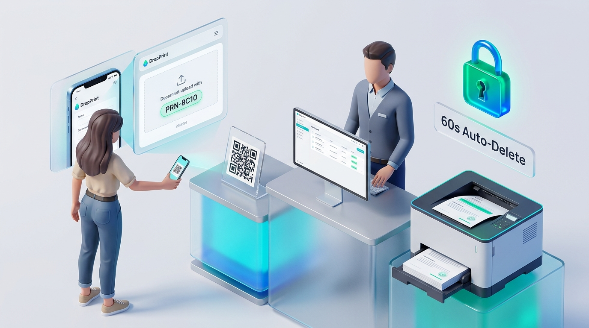
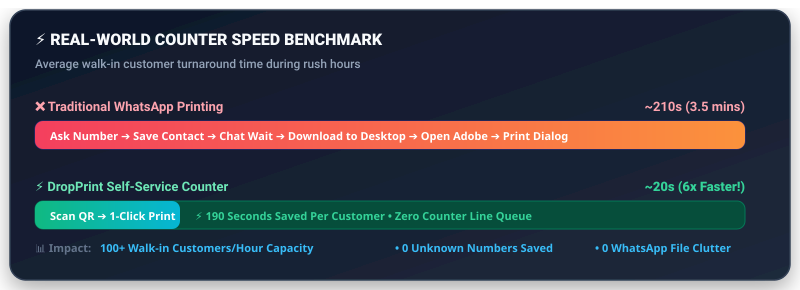
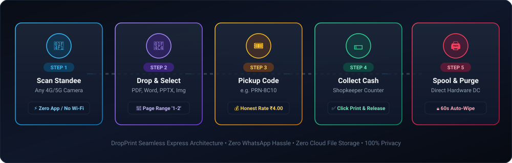
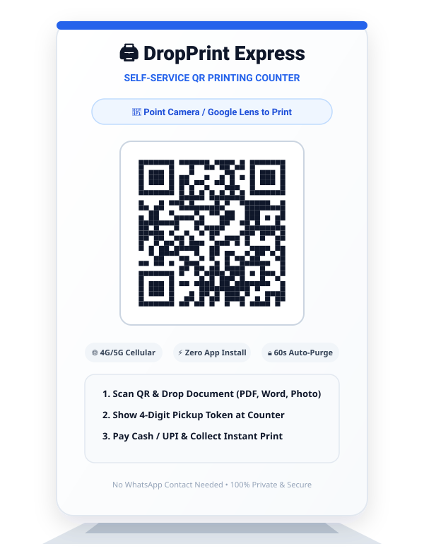
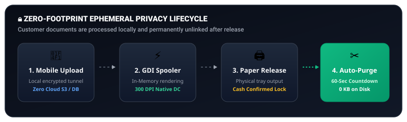

<div align="center">

# 🖨️ DropPrint
### The Autonomous Self-Service Printing Counter for Windows

**Turn any Windows PC and USB/Wi-Fi printer into an express, contactless printing kiosk.**  
Customers scan a QR code on mobile (4G/5G or Wi-Fi), drop documents, and get prints in seconds.

<br/>

[](https://microsoft.com)
[](#-why-dropprint)
[](#-key-capabilities)
[](#-privacy--zero-footprint-guarantee)
[](LICENSE)

<br/>



</div>

<br/>

---

## 🛑 The Problem with Traditional Shop Printing

In millions of copy shops, cyber cafes, and Jan Seva Kendras, printing a simple document is slow, frustrating, and insecure:

| Traditional Print Shop | The DropPrint Standard |
|:---|:---|
| ❌ *"Bhaiya, WhatsApp number batao"* — saving dozens of unknown contacts daily | ✅ **100% QR-Code Based** — No phone numbers or app downloads |
| ❌ Personal photos, Aadhaar cards, and chats cluttered on shop phone | ✅ **Zero Phone Storage** — Customer files go straight to counter queue |
| ❌ USB cables and pendrives infecting shop PC with viruses & malware | ✅ **Sandboxed Mobile Upload** — Encrypted browser payload only |
| ❌ Slow print dialogs (Acrobat / Chrome) freezing the counter computer | ✅ **Silent Windows GDI Spooling** — Zero popups, instant print |
| ❌ Customer files left lingering on the desktop indefinitely | ✅ **60-Second Auto-Purge** — Complete hardware disk shred after print |
| ❌ Arguments over page count and rates after printing | ✅ **Live Real-Time Quoting** — Transparent price calculated upfront |

<br/>

<div align="center">
  
</div>

---

## ⚡ How It Works: The 5-Step Express Flow

<div align="center">
  
</div>

<br/>

```
  [ 1. Scan QR ] ──► [ 2. Drop Document ] ──► [ 3. Get 4-Digit Token ] ──► [ 4. Cash Confirm ] ──► [ 5. Instant Print ]
   Any 4G/5G Phone       PDF, Word, Images        e.g. PRN-8C10 (₹6.00)       Shopkeeper Screen      Auto-Purged in 60s
```

1. **Scan Standee QR:** Walk-in customer scans the laminated counter QR with their mobile camera. Works instantly over mobile 4G/5G or shop Wi-Fi without installing any app.
2. **Upload & Configure:** Customer drops their PDF, Word (`.docx`), Excel (`.xlsx`), PPT, or Photo. Custom page ranges (e.g., `1-3, 5`) recalculate price dynamically on-screen.
3. **Instant Pickup Code:** Customer gets an instant 4-digit pickup token (e.g. `PRN-8C10`) with exact pricing.
4. **Collect Cash:** Customer pays cash or UPI at the counter. The shopkeeper clicks **`[Release & Print]`**.
5. **Silent Print & Shred:** Direct Windows GDI spooler sends pages straight to the hardware tray. The document is permanently shredded from the PC disk within 60 seconds.

---

## 💎 Key Capabilities

* 🖨️ **Direct Hardware GDI Spooler**  
  Bypasses third-party viewers (Acrobat, Chrome). Renders pages directly into the Windows Device Context at native 300+ DPI printer resolution. Compatible with all HP LaserJet, Canon LBP, Epson EcoTank, and Brother USB/Wi-Fi printers.

* 🌐 **Cellular 4G/5G & Local LAN Transit**  
  Customers connect via high-speed encrypted tunnels on their own mobile data (Jio, Airtel, Vi) without asking for the shop's Wi-Fi password. Also functions completely offline on local LAN.

* 📑 **Dynamic Page-Range & Live Billing Engine**  
  Customers can select exact page subsets (`1-5`, `3, 7-10`). The engine instantly recalculates page count and live cost before submission, eliminating billing disputes.

* 📄 **Headless Office Auto-Converter**  
  Converts Word resumes (`.docx`), fee spreadsheets (`.xlsx`), and presentations (`.pptx`) into print-ready PDFs in under 2 seconds in the background.

* 🔒 **60-Second Ephemeral Privacy Shredder**  
  Customer files never stay on the shopkeeper's PC. A background privacy cleaner permanently unlinks uploaded files and spool caches 60 seconds after release.

* 🏷️ **1-Click Physical Counter Standee Generator**  
  The dashboard instantly produces print-ready A4 QR standees with zero design effort. Print, laminate, and stick it on the counter glass for 100% self-serve customer guidance.

<br/>

<div align="center">
  
  <br/>
  <sub><i>A4 Counter Standee auto-generated from the Shopkeeper Dashboard</i></sub>
</div>

---

## 🚀 1-Click Setup for Shopkeepers

### Single-Click Installer (`DropPrint_Setup.exe`)
No Python, Git, or command-line setup required.

1. Download **`DropPrint_Setup.exe`** from the [Releases](dist/) section.
2. Run the installer and click **Install**.
3. **Automated Setup:**
   * Installs to `C:\DropPrint`
   * Creates **"🖨️ DropPrint Counter"** Desktop Shortcut
   * Configures automatic launch on Windows startup
   * Opens the Shopkeeper Dashboard at `http://localhost:8000/shopkeeper/`

> 📖 **Deploying to a live shop?** See the practical counter operations handbook: [HANDOVER_GUIDE.md](HANDOVER_GUIDE.md)

---

## 🔒 Privacy & Zero-Footprint Guarantee

<div align="center">
  
</div>

<br/>

DropPrint is built with a **strict local-first architecture**:
* **No Cloud File Storage:** Documents never touch external storage buckets or third-party servers. All processing happens locally in-memory and on the shop PC.
* **Cash Gate Protection:** No document can be printed without explicit operator cash/UPI confirmation.
* **Automatic Shredding:** Uploaded files and rendered spool sheets are permanently purged from the storage disk 60 seconds after printing.

---

## 💻 Tech Stack

* **Operating System:** Windows 10 / 11 (64-bit)
* **Backend Engine:** FastAPI & Python 3.12 (High-throughput async event loop)
* **Print Subsystem:** Windows Win32 GDI Spooler API (`win32print`, `pypdfium2` at 300 DPI)
* **Network Transit:** Cloudflare Quick Tunnel (Zero-config SSL mobile ingress) & Local LAN
* **Frontend:** Responsive Vanilla ES6+ Web Interface (Zero framework overhead)

---

## 📄 License

Distributed under the [MIT License](LICENSE). Built for cyber cafes, photocopy shops, and Jan Seva Kendras.
